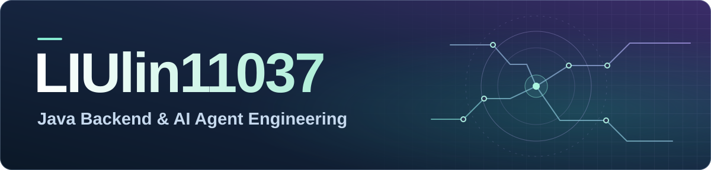

## 👋 关于我

我做 Java 后端，也用 Python 和 LangGraph 开发 Agent。一条投递通知迟迟没到，我想知道它卡在哪一步，也想知道补发之后怎么验证。做调研报告时，我也希望能顺着引用找到原始证据。

我也会在项目里记录设计取舍、踩过的坑和复现步骤，方便以后回过头验证当时的判断。

## 🛠️ 我的项目

### [CiteTrace](https://github.com/LIUlin11037/CiteTrace) · 多智能体深度研究

用 LangGraph 编排任务拆解、并行取证、证据审校和报告撰写。支持联网检索与本地知识库，并用程序核验引用的 URL 或文件页码。

### [OpsPilot](https://github.com/LIUlin11037/OpsPilot) · 微服务故障诊断 Agent

用 RabbitMQ 队列指标、HTTP 健康检查和业务快照排查消息积压、服务异常和投递通知问题，并在报告里记录诊断结论和证据来源。

### [HireHub](https://github.com/LIUlin11037/HireHub) · 招聘平台微服务

覆盖职位发布、投递、面试和 Offer。投递链路用本地消息表、RabbitMQ 和定时对账实现失败补偿，保证最终一致性。

## 💻 技术栈

### 后端与微服务

### Agent、检索与评测

### 存储与搜索

### 消息与部署

